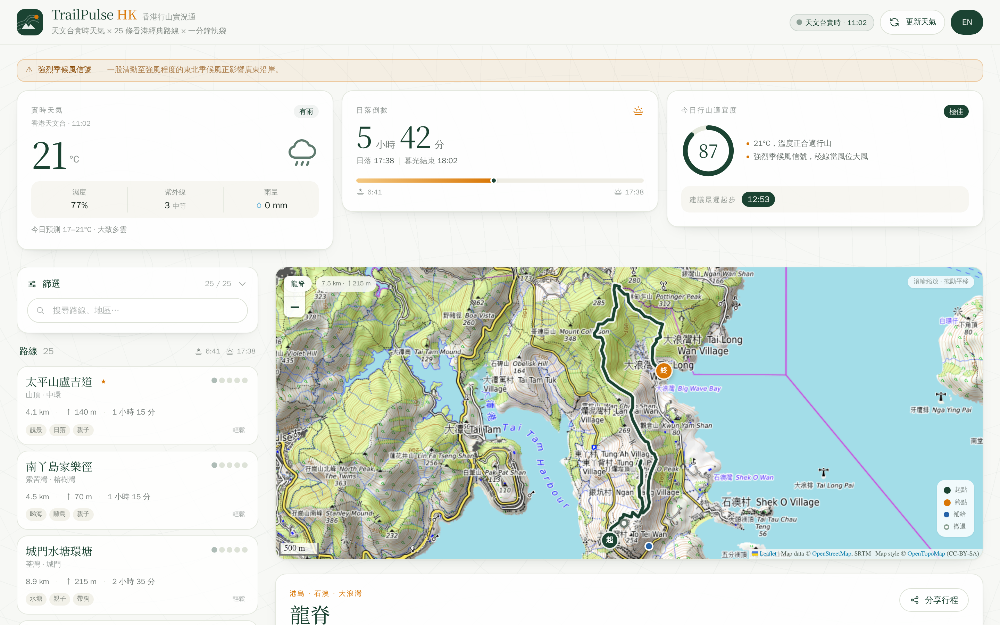

# TrailPulse HK · 香港行山實況通

香港天文台實時天氣 × 25 條經典行山路線 × 一分鐘執袋清單。

一個以「而家出發，去邊行、帶咩」為中心的行山儀表板：左邊揀路線，右邊即時睇地圖、海拔剖面同今日執袋清單；天氣、日落倒數同「今日行山適宜度」直接讀天文台開放數據。



## 功能

**今日實況（Server-side 實時讀天文台）**
- `rhrread` 分區氣溫、濕度、紫外線、雨量；`warnsum` 生效警告；`flw`／`fnd` 今日預測與未來幾日。
- 以 NOAA 公式在本機計算香港日出、日落、暮光結束時間（誤差 < 1 分鐘），即時倒數。
- 「今日行山適宜度」0–100 分：綜合氣溫、濕度、UV、雨量、警告同剩餘日照，附原因及**建議最遲起步時間**（4 小時行程 + 45 分鐘緩衝）。
- 每條路線另計「預計完成時間」同「日落前緩衝」，日照不足會出警告。
- 天文台讀取失敗時自動用最後一次資料並標示，唔會白畫面。

**25 條香港經典路線（真實 OSM 行山徑幾何 + SRTM 高程）**
- 龍脊、獅子山、麥理浩徑 1／2／3／4／7／8 段、千島湖清景台、城門水塘環塘、大東山、鳳凰山、太平山盧吉道、嘉頓山、梧桐寨瀑布、鶴咀、釣魚翁、南丫島家樂徑、橋咀洲、魔鬼山、青山腹地、八仙嶺、大欖涌水塘、大潭水塘群、東澳古道等。
- 每條有距離、爬升／下降、最高點、預計時間、樹蔭比例、難度、特色標籤、亮點、起終點交通、補給點、撤退點。
- 路線幾何由 OpenStreetMap 行山徑經 BRouter `hiking-beta` 路徑計算，再以 SRTM 30m 高程重采样成海拔剖面；唔係手繪直線。
- Leaflet 互動地圖：起點／終點（環線用「起終」）、補給、撤退點標示；OpenTopoMap 等高線底圖。
- Recharts 海拔剖面圖，hover 顯示每公里高度。

**篩選與行程工具**
- 難度、時長、地區、15 種特色標籤篩選＋搜尋＋四種排序（今日推介／最短／最易／爬升最多）。
- 自動執袋清單：按路線時數、爬升、樹蔭、開揚度同實時天氣計出建議水量（公升）、電解質、防曬、雨具、風褸、頭燈、行山杖、手套、蚊怕水等，每項有原因，可逐項剔。
- 繁中／English 一鍵切換。
- 行程可分享：路線、語言、篩選全部 encode 喺 URL query，開返即還原。

## 路線一覽

| 路線 | 地區 | 距離 (km) | 爬升 (m) | 時間 | 難度 |
|---|---|---|---|---|---|
| 龍脊 / Dragon's Back | 港島 | 7.5 | 215 | 2h20 | 容易 |
| 獅子山 / Lion Rock | 九龍 | 4.4 | 450 | 2h10 | 中等 |
| 麥理浩徑第一段 · 萬宜東壩 / MacLehose Trail Section 1 · High Island | 新界東 | 12.7 | 290 | 3h45 | 容易 |
| 麥理浩徑第二段 · 大浪四灣 / MacLehose Trail Section 2 · Tai Long Bays | 新界東 | 13.8 | 650 | 5h15 | 中等 |
| 麥理浩徑第三段 · 嶂上高原 / MacLehose Trail Section 3 · Cheung Sheung | 新界東 | 9.7 | 515 | 3h55 | 挑戰 |
| 麥理浩徑第四段 · 馬鞍山 / MacLehose Trail Section 4 · Ma On Shan | 新界東 | 14.1 | 995 | 6h20 | 挑戰 |
| 麥理浩徑第七段 · 針山草山 / MacLehose Trail Section 7 · Needle Hill | 新界西 | 6.8 | 570 | 3h05 | 中等 |
| 麥理浩徑第八段 · 大帽山 / MacLehose Trail Section 8 · Tai Mo Shan | 新界西 | 8 | 590 | 3h40 | 挑戰 |
| 千島湖清景台 / Thousand Island Lake Viewpoint | 新界西 | 9.1 | 250 | 2h45 | 容易 |
| 城門水塘環塘 / Shing Mun Reservoir Loop | 新界西 | 8.9 | 215 | 2h35 | 輕鬆 |
| 大東山 · 爛頭營 / Sunset Peak · Sunset Villa | 大嶼山 | 6.9 | 515 | 3h05 | 中等 |
| 鳳凰山 / Lantau Peak | 大嶼山 | 5.2 | 560 | 2h45 | 挑戰 |
| 太平山盧吉道 / Victoria Peak · Lugard Road | 港島 | 4.1 | 140 | 1h15 | 輕鬆 |
| 嘉頓山 / Garden Hill | 九龍 | 2.1 | 55 | 35 分 | 輕鬆 |
| 梧桐寨瀑布 / Ng Tung Chai Waterfalls | 新界東 | 4.2 | 380 | 1h55 | 容易 |
| 鶴咀 / Cape D'Aguilar | 港島 | 4.7 | 145 | 1h20 | 輕鬆 |
| 釣魚翁 / High Junk Peak | 新界東 | 5.9 | 210 | 2h00 | 中等 |
| 南丫島家樂徑 / Lamma Island Family Trail | 離島 | 4.5 | 70 | 1h15 | 輕鬆 |
| 西貢橋咀洲 / Sharp Island · Kiu Tsui | 新界東 | 1.3 | 0 | 0h20 | 輕鬆 |
| 魔鬼山炮台 / Devil's Peak Batteries | 九龍 | 2.8 | 145 | 1h00 | 輕鬆 |
| 青山腹地 / Castle Peak | 新界西 | 5.8 | 415 | 2h35 | 挑戰 |
| 八仙嶺 / Pat Sin Leng | 新界東 | 7.1 | 555 | 3h15 | 挑戰 |
| 大欖涌水塘 / Tai Lam Chung Reservoir | 新界西 | 9.7 | 350 | 3h10 | 容易 |
| 大潭水塘群 / Tai Tam Reservoirs | 港島 | 9.9 | 395 | 3h15 | 容易 |
| 東澳古道 / Tung O Ancient Trail | 大嶼山 | 13.7 | 275 | 4h05 | 容易 |

## 技術

- **Next.js 15.5.29**（App Router）＋ **React 19** ＋ **TypeScript**（strict）＋ **Tailwind CSS**
- **Leaflet 1.9**（`dynamic(..., { ssr: false })`，避免 SSR 時 window 問題）
- **Recharts 2.15**（海拔剖面圖）
- 天文台 API 由 Server Component 即時 fetch（`cache: "no-store"`），另設 `/api/weather`（`dynamic = "force-dynamic"`、`Cache-Control: no-store`）供前端手動更新；頁面同 API 都唔會被靜態預渲染或 CDN 快取，永遠顯示最新讀數。
- `overrides: { "postcss": "^8.5.33" }`，`npm audit` 保持 0 vulnerabilities。
- 零後端、零資料庫、零追蹤、零廣告；可直接部署 Vercel。

## 開發

```bash
npm install
npm run dev        # http://localhost:3000
npm run build && npm start
npm run lint       # eslint
npx tsc --noEmit   # 型別檢查
npm audit          # 0 vulnerabilities
```

### 重新產生路線資料

```bash
node scripts/build-geometry.mjs            # 全部路線（可只跑指定 id，逗號分隔）
node scripts/geocode.mjs 0 40              # 用 Nominatim 覆核座標（可選）
```

`scripts/route-defs.mjs` 係人手整理的路線定義（名稱、難度、交通、補給、途經點）；`scripts/build-geometry.mjs` 會逐段用 BRouter hiking profile 取真實路徑同高程，計距離、爬升、下降、最高點，輸出 `data/routes.json`（已 commit，前端直接 import）。

## 驗證

- `tsc --noEmit`、`eslint .`、`next build` 全部通過；`npm audit` 0 vulnerabilities。
- 無頭 Chromium（Playwright）於 **1440×900、980×1400、390×844** 三個視口各跑 18 項檢查（54 項全過）：地圖路線與標記、海拔圖、篩選、URL 同步、路線切換、清單打勾、複製分享連結、中英切換、分享 URL 還原、零 console／page error、零橫向溢出。
- 截圖：`docs/desktop.png`、`docs/mobile.png`。

## 資料來源與聲明

- 天氣及警告：香港天文台開放數據（`rhrread`、`warnsum`、`flw`、`fnd`），每 10 分鐘更新。
- 路線幾何：© OpenStreetMap 貢獻者（ODbL），經 BRouter `hiking-beta` 計算。
- 高程：SRTM 30m（OpenTopoData）。
- 底圖：© OpenStreetMap 貢獻者、SRTM｜地圖風格 © OpenTopoMap（CC-BY-SA）。
- 時間、爬升、樹蔭等屬估算，實際路況會變；出發前請再核對天文台警告、漁護署公告及現場情況，量力而為。

## License

MIT
